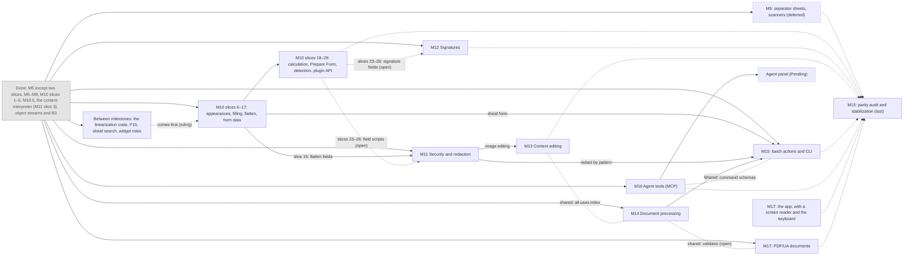

# Roadmap

How sheaf gets from v0.1 ("the fast workpaper binder") to feature parity with
**Adobe Acrobat Pro** plus the **CCH ProSystem fx PDFlyer** workpaper tools.
"Parity" means Acrobat Pro's *desktop* feature set and PDFlyer's tax/audit
tools; Adobe's cloud features are [not planned](plan/not-planned.md).

**Ordering principle:** among milestones whose dependencies are met, the next
thing a tax/audit preparer would otherwise open Acrobat for comes first. The
hardest engine work (in-place content editing) comes late. Between
milestones, work with a wide reach can go first (Greg, 2026-10-23):
capability or speed that much of sheaf uses, or work that can be published
as a [library](plan/libraries.md) of its own. Release numbers aren't
tracked: everything is pre-release, so dependencies decide the order.

This file is the index. Each milestone's card (linked in the table) has its
summary, where it stands, its slices and their dependencies, and links down
to the slice files, decisions, proposals and research. Finished work moves
to [plan/complete/](plan/complete/). For agents: [AGENTS.md](AGENTS.md).

## Now and next

In order ([between milestones](plan/between/README.md)):

1. **The linearization crate:** Fast Web View, as a crate of its own, on
   object streams' grouping by page ([done](plan/complete/object-streams.md)).
2. **[F15](plan/backlog/F15.md):** a Rewrite that doesn't load the whole
   file.
3. **`sheaf search`** over files and folders.
4. **Roles and labels on sheaf-ui's widgets:** M17's first slice.

Then [M10](plan/m10-forms/README.md) slices 6–17, Fill & Sign
([M12](plan/m12-signatures/README.md) slice 1), [M11](plan/m11-security/README.md),
then M16, M10 slices 18–29 and the rest, in an order still open.

Deferred: [M5](plan/m05-scan/README.md)'s scanners and separator sheets (no
scanners to test against), PAdES signing (RustCrypto's cms 0.3 round).

Waiting on Greg: [open questions](plan/asks.md).

## Milestones

M0–M4 (spikes, viewer, organizer, markup, polish) made v0.1: see
[the MVP](plan/complete/mvp.md).

| # | Milestone | Proves | Status | Depends on |
|---|---|---|---|---|
| [M5](plan/m05-scan/README.md) | **Scan & OCR**: searchable text layer, scan cleanup, scanner intake, separator sheets | Scanned binders become searchable | Deferred: done except scanner intake and separator sheets | Nothing unbuilt |
| [M6](plan/complete/m06-plugins.md) | **Plugins**: WASM components, declarative UI, command registry | Extensibility without forking | Done | — |
| [M7](plan/complete/m07-viewing.md) | **Viewing & output**: page modes, split view, panels, print, image/TIFF/text export | Viewing and printing never need Acrobat | Done | — |
| [M8](plan/complete/m08-page-tools.md) | **Page tools**: split, insert/replace, crop, labels, headers/footers, Bates, watermarks | Binder assembly is complete | Done | — |
| [M9](plan/complete/m09-markup.md) | **Markup completion**: mark editing, annotation types, custom stamps, replies and status, PDFlyer tools, FDF/XFDF, measurement | Review workflow parity | Done | — |
| [M10](plan/m10-forms/README.md) | **Forms**: fill, calculate, create, import/export, flatten | Tax forms are filled and calculated in sheaf | Paused after slice 5; slices 6–17 resume after the work between milestones | Nothing unbuilt |
| [M10.5](plan/complete/m10.5-edit-api/README.md) | **The edit API**: page content in the model, one op vocabulary over one primitive, saves as outputs, one emitter for screen and file | M11–M15 edit content without reworking the core | Done | — |
| [M11](plan/m11-security/README.md) | **Security & redaction**: true redaction, sanitize, passwords and permissions | Client data can be sent out safely | Planned; slice 3 (the content interpreter) done | M10 slice 15, for flattening in Remove Hidden Information; M10 slices 23–26 if sanitize removes field scripts (open) |
| [M12](plan/m12-signatures/README.md) | **Signatures**: Fill & Sign, digital signatures, verification, timestamps | Engagement letters and 8879s are signed in-app | Sketched; Fill & Sign goes early | M10 slices 23–26 if signing creates signature fields (open) |
| [M13](plan/m13-content-editing/README.md) | **Content editing**: text, images, links, objects | The hardest Acrobat feature | Sketched | M11 (image editing) |
| [M14](plan/m14-processing/README.md) | **Document processing**: compare, optimize, PDF/A | Archival and output parity | Sketched | Nothing unbuilt |
| [M15](plan/m15-automation/README.md) | **Automation**: batch actions, CLI, parity audit | Acrobat Pro + PDFlyer parity | Sketched; CLI groundwork shipped | Batch: each step's milestone. Parity audit: last |
| [M16](plan/m16-agent/README.md) | **Agent tools (MCP)**: `sheaf mcp`, through which an agent reads a document as a plugin does and builds transactions from ops, with approval | Agents work on documents through sheaf's own ops | Sketched | Nothing unbuilt |
| [M17](plan/m17-accessibility/README.md) | **Accessibility**: sheaf with a screen reader and the keyboard; PDF/UA documents | People who use assistive technology can use sheaf and read what it writes | Sketched; its first slice goes early | Documents: M14's PDF/A validator, if PDF/UA's rules share it (open) |

**Depends on** lists the unbuilt work a milestone needs first, or the part
named after "for". Finished work isn't listed. "(open)" marks an edge that
waits on a decision. Solid arrows below are needed; dotted ones are soft,
open, or a ruling on order.

## Everything else

- [Open questions for Greg](plan/asks.md), one line each.
- [The backlog](plan/backlog/README.md): bugs and features found along the
  way, one file per entry.
- [Pending](plan/pending.md): proposals not yet placed in a milestone.
  [Parity checklist](plan/parity.md) · [Libraries](plan/libraries.md) ·
  [Not planned](plan/not-planned.md).
- [Topics](plan/topics/): code signing, the installer, the GPUI bump, file
  contention, and [plugins](plan/topics/plugins/README.md).
- [Build or adopt](plan/research/build-or-adopt/README.md): every need,
  crate by crate (audit, 2026-10-23).
- [Finished work](plan/complete/): the plans and slice notes of finished
  milestones and slices, and closed backlog entries.
- For users: [what works today](README.md#what-works-today) and [the
  feature matrix](docs/features.md).
